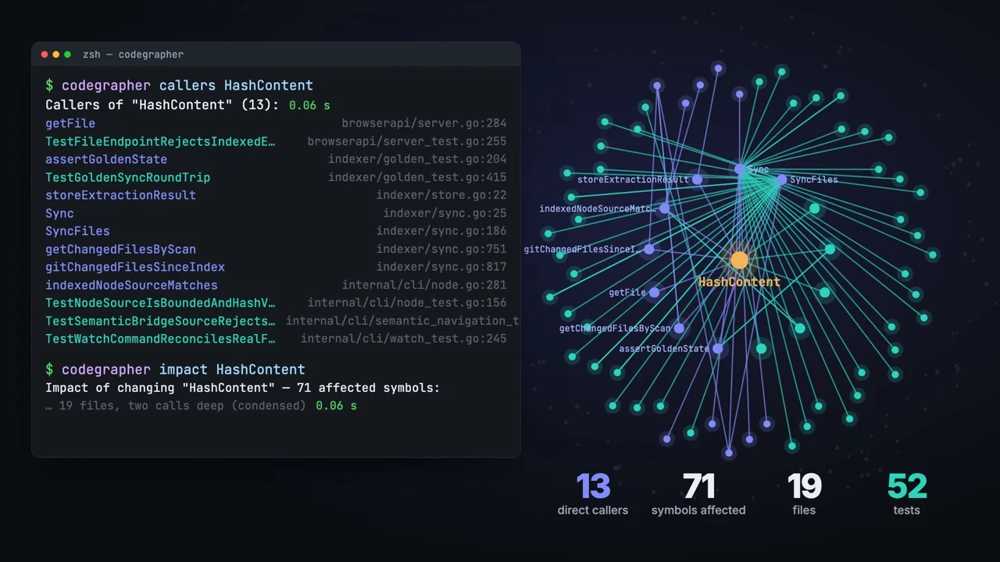

# setup-codegrapher

[](https://youtu.be/LQ5ls_C4hOE)

[Watch the CodeGrapher product video](https://youtu.be/LQ5ls_C4hOE)

Install an exact [CodeGrapher](https://github.com/code-grapher/codegrapher) release in GitHub Actions without Go. This action installs the CLI only; workflows choose which commands to run.

`version` is required and must be an exact release tag. `expected-sha256` optionally supplies an independently obtained digest for the selected platform archive. The release checksum file detects corruption but cannot authenticate a release if both archive and checksum are replaced. Outputs include the installed release tag and binary path.

Linux and macOS support amd64 and arm64; Windows supports amd64 where the release contains those assets.

```yaml
- uses: actions/checkout@3d3c42e5aac5ba805825da76410c181273ba90b1 # v7.0.1
- uses: code-grapher/setup-codegrapher@caac0a5f4ffa83d842eed23494b74605b0bb5f3a
  with:
    version: v0.16.0
- run: codegrapher --version
```
